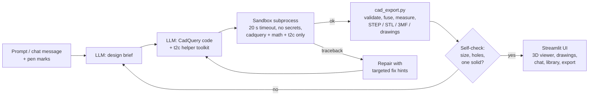

---
title: Fillet
colorFrom: gray
colorTo: green
sdk: docker
app_port: 7860
pinned: false
short_description: Describe a part in plain English, get editable CAD.
---

# Fillet

Describe a part in plain English and get an editable, measured 3D CAD model: STEP for CAD, STL/3MF for printing.
An LLM (Groq / Mistral, with automatic failover) writes [CadQuery](https://github.com/CadQuery/cadquery) code from a
short design brief, the code runs in an isolated subprocess, and the result is checked (validity, size, holes),
repaired automatically when needed, and shown in an interactive 3D viewer with dimensioned drawings.
You then refine it by chat, or by drawing on the model with a pen tool.

> _Screenshot / GIF placeholder: `docs/demo.gif`_

## Features

- **Text → CAD**: Mistral or Groq writes CadQuery; a sandboxed subprocess runs it; failures *and* geometry mismatches are fed back for up to 3 repairs.
- **Robust helper toolkit (`t2c.py`)**: tested building blocks the LLM can call instead of fragile raw CadQuery (organic lofts along X/Z, revolves, pin/tuft grids, fuzzy unions, fillets that never crash or hang), plus a design-brief step before coding, so vague prompts like "a toothbrush" or "a coffee mug" produce realistic parts. If no attempt passes every check, the best valid model is returned as a draft instead of nothing.
- **Chat to fix it**: after the first build the prompt slides left and becomes a chat ("make the holes 6 mm"); each message edits the current model.
- **Pen markup**: draw on the 3D preview to mark a problem; rough circles, ellipses, boxes and arrows snap to clean shapes and become numbered pins on the surface. Their exact 3D coordinates and face are sent with your next chat message ("fix #1").
- **Model library**: save models (files + full chat history) and reopen them from the sidebar to keep editing.
- **Automatic model failover**: an ordered chain of Groq / Mistral models; daily quota, unavailable model or bad key → the next model takes over and the exhausted one is remembered until it resets (`LLM_CHAIN` in `.env` to customise).
- **Interactive 3D preview** (three.js: rotate, wireframe, grid) + **2D drawing views** (iso / top / front / side).
- **Validation panel**: bounding box, volume, surface area, solid validity.
- **3D-print mode**: designs for FDM (flat base, ≥1.2 mm walls, few overhangs) and reports printer fit, overhang/support check, filament weight and rough print time for Ender-3 / Prusa / Bambu build volumes.
- **Export**: STEP, STL, 3MF, BREP, SVG, `.py`; *Open in my CAD app* / *Open 3MF in my slicer* (Windows file association); save everything to a folder.
- **Share**: one-click ZIP bundle (all formats + prompt + README) and a standalone `viewer.html` anyone can open in a browser.

## Architecture



| File | Role |
|------|------|
| `app.py` | Streamlit UI: landing page, chat + preview workspace, library drawer, export/share, print report |
| `llm.py` | LLM client with model failover, design brief, repair hints, history trimming |
| `pipeline.py` | Generate -> run -> repair / self-check loop; returns the best valid model as a draft if needed |
| `sandbox.py` | Runs generated code in a child process (`python -I`), restricted builtins/imports, no env secrets, 20 s timeout |
| `t2c.py` | Robust CadQuery building blocks the LLM uses (lofts, revolves, pin grids, safe fillets, fuzzy unions) |
| `cad_export.py` | Validation, hole detection, STEP/STL/3MF/BREP export, dimensioned SVG drawings |
| `components/cad_viewer/` | Two-way three.js viewer: dimensions, smooth zoom, pen marks with shape snapping |
| `config.py` | Local vs. server mode, access password, per-visitor build limit |
| `eval.py` | Runs the prompts in `examples/examples.json` and reports success and dimension error |

> The sandbox gives process isolation, a hard timeout, a minimal namespace and no access to API keys.
> It is not a hardened security boundary, so public deployments should run in a container (see below).

## Run locally

You need a free API key from [Groq](https://console.groq.com/keys) (and optionally [Mistral](https://console.mistral.ai/)).

**Windows (PowerShell)**

```powershell
.
un.ps1
```

**macOS / Linux**

```bash
./run.sh
```

The first run creates a Python 3.11 virtual environment, installs everything and creates `.env` from `.env.example`.
Put your key(s) in `.env` and run the script again. The app opens at http://localhost:8501.

**Docker** (no Python needed)

```bash
cp .env.example .env    # then add your key(s)
docker compose up --build
```

Then open http://localhost:7860. Saved models persist in `./library`.

## Deploy (free, public link for your portfolio)

The repo is ready for a **Hugging Face Space** (Docker SDK; the header at the top of this README configures it).

1. Create a Space at https://huggingface.co/new-space: pick **Docker** as the SDK, then **Blank**.
2. In the Space **Settings -> Variables and secrets**, add secrets `GROQ_API_KEY` (and optionally `MISTRAL_API_KEY`,
   `APP_PASSWORD` to make it private).
3. Push this repo to the Space:

   ```bash
   git remote add space https://huggingface.co/spaces/<your-username>/fillet
   git push space main
   ```

The Space builds the `Dockerfile` and serves the app at `https://huggingface.co/spaces/<your-username>/fillet`.
In a Space, server mode turns on automatically: a per-visitor limit of 12 builds/hour (`MAX_BUILDS_PER_HOUR`),
an optional password, and buttons that act on the host computer ("open in my CAD app") are hidden.
Note: the free Space disk is not persistent, so the model library resets when the Space restarts.

## Evaluation

```powershell
python eval.py --update-readme
```

Bounding-box error compares sorted dimensions (so part orientation doesn't matter) against the size requested in the prompt.

<!-- EVAL:START -->
_Not run yet._
<!-- EVAL:END -->
